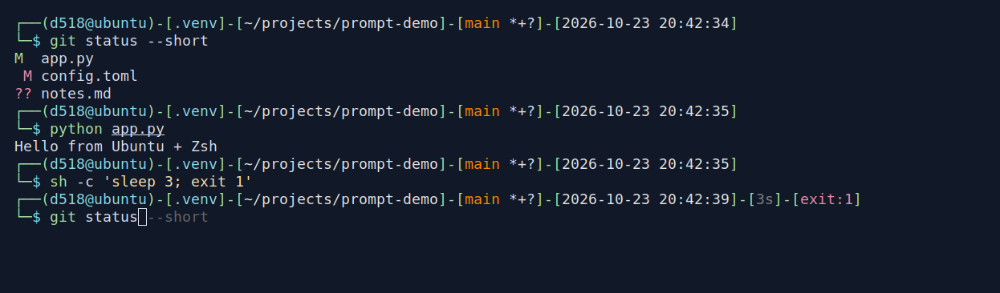

# Kali-inspired Zsh

[](LICENSE)
[](docs/configuration.md)
[](docs/development.md#驗證紀錄)

受 Kali Linux 終端機風格啟發的輕量 Zsh 設定，已在 Ubuntu 與 Fedora 的 WSL2 環境驗證。
保留雙行提示符、時間、Git 狀態、自動建議與語法高亮，不需要額外的設定框架。

## 效果預覽



Ubuntu 實際執行畫面：顯示 Git 變更、Python 虛擬環境、慢速失敗指令的耗時與退出碼；最後一行的灰字為自動建議。

## 功能

| 功能 | 簡介 |
|---|---|
| 雙行提示符 | 顯示使用者、主機、路徑與時間，預設使用 `@` 分隔使用者與主機 |
| Git 狀態 | 分支、工作區變更、暫存、未追蹤檔案、stash 及超前／落後狀態 |
| 指令退出碼與耗時 | 失敗時顯示退出碼，執行至少 3 秒時顯示耗時 |
| 自動建議與語法高亮 | 預設啟用，兩個插件可各自關閉 |
| 環境與路徑提示 | 偵測 Python 環境，長路徑省略中間層級，保留完整目錄名稱 |
| 常用指令 | `mkcd`、`extract`、`pkgup`、`pkgclean` 與少量常用 alias |

已測試：**Ubuntu 26.04.1、Fedora 44（WSL2、Zsh 5.9）**。其他發行版尚未測試。

## 安裝

### 1. 安裝基本套件

Ubuntu（APT）：

```sh
sudo apt update
sudo apt install zsh git ca-certificates
```

Fedora：

```sh
sudo dnf install zsh git ca-certificates
```

### 2. 取得專案

```sh
git clone https://github.com/MeowXiaoXiang/kali-inspired-zsh.git
cd kali-inspired-zsh
```

若已下載專案，直接進入專案根目錄即可。

### 3. 安裝選用功能

推薦安裝以下兩個插件，提供**自動建議與語法高亮**。安裝後預設會自動載入：

```sh
mkdir -p ~/.zsh/plugins
git clone https://github.com/zsh-users/zsh-autosuggestions.git ~/.zsh/plugins/zsh-autosuggestions
git clone https://github.com/zsh-users/zsh-syntax-highlighting.git ~/.zsh/plugins/zsh-syntax-highlighting
```

已有插件目錄時略過對應的 `git clone`。兩個插件都能獨立關閉；沒安裝也能正常啟動。

若要使用 `extract` 支援的全部格式，請安裝以下解壓工具：

```sh
# Ubuntu（APT）
sudo apt install tar gzip bzip2 xz-utils unzip

# Fedora：使用這行取代上面的 APT 指令
sudo dnf install tar gzip bzip2 xz unzip
```

### 4. 檢查、備份並套用

在專案根目錄執行：

```sh
zsh -n .zshrc && (
  if [ -e ~/.zshrc ] || [ -L ~/.zshrc ]; then
    cp -p -- ~/.zshrc ~/.zshrc.bak.$(date +%Y%m%d%H%M%S) || exit 1
  fi
  cp -- .zshrc ~/.zshrc
)
```

這段指令會先備份原有設定，再更新 `~/.zshrc`。若 `~/.zshrc` 是符號連結，複製會寫入連結指向的檔案；請依原本的管理方式更新。

執行 `zsh` 試用。若要設為預設 Shell，再執行：

```sh
chsh -s "$(command -v zsh)"
```

更新方式見[更新設定](docs/usage.md#更新設定)；需要回復舊設定時，請參考[還原設定與切回 Bash](docs/troubleshooting.md#還原設定與切回-bash)。

## 設定

在 `~/.zsh_config` 設定功能開關與參數，不必直接修改專案檔案。例如：

```zsh
PROMPT_HOST_SYMBOL="㉿"
ENABLE_AUTOSUGGESTIONS="Y"
ENABLE_SYNTAX_HIGHLIGHTING="Y"
ENABLE_SYSTEM_LOAD="Y"
ENABLE_PATH_SHORTENING="Y"
```

範例中的功能預設都已開啟，改為 `"N"` 即可關閉。時間同樣預設開啟；路徑維持 Linux 格式。

## 文件

| 文件 | 內容 |
|---|---|
| [操作手冊](docs/usage.md) | 指令、按鍵、Git 符號、解壓與套件維護 |
| [設定手冊](docs/configuration.md) | 所有開關、預設值、個人設定與載入順序 |
| [疑難排解](docs/troubleshooting.md) | 插件、補全、按鍵、狀態更新與還原方式 |
| [開發與驗證](docs/development.md) | 測試方法、已測平台、開發約定與限制 |

本專案使用 [MIT 授權](LICENSE)。
